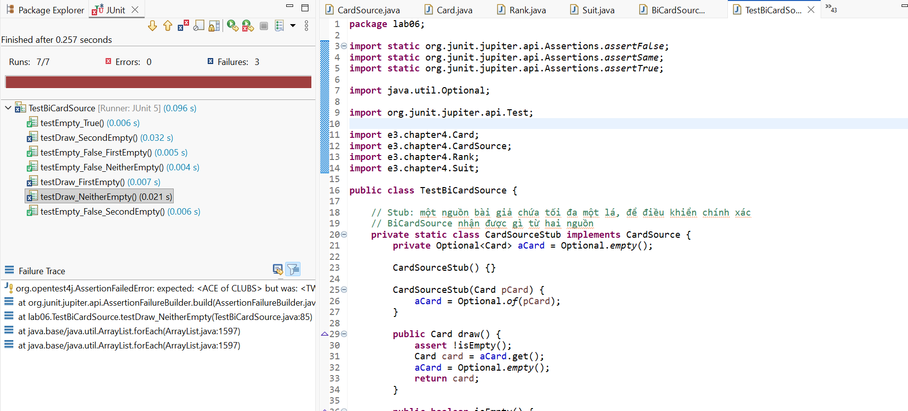
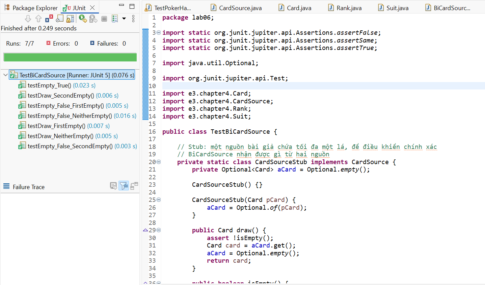
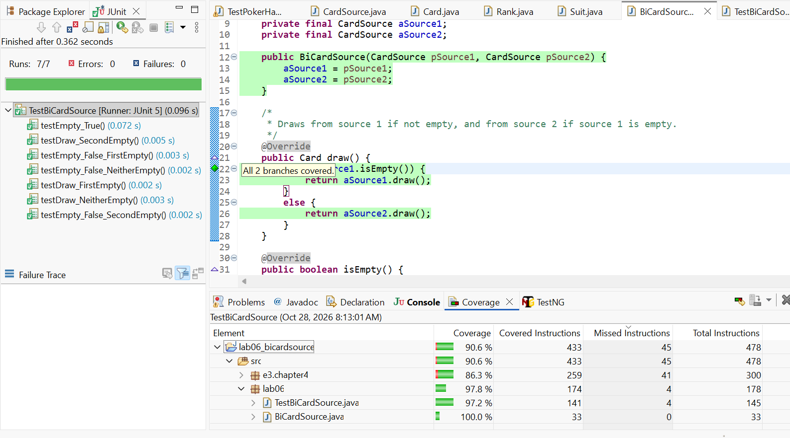
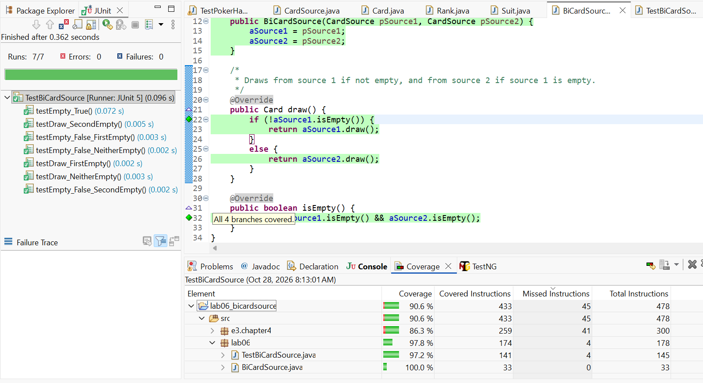

# Lab 06 – Exercise 11: Kiểm thử BiCardSource bằng stub, đạt 100% branch coverage

| | |
|---|---|
| **Họ và tên** | Lê Anh Khoa |
| **MSSV** | 4651050119 |
| **Lớp** | 46D |
| **Bài** | Lab 06 – Exercise 11 (Chapter 5, *Introduction to Software Design with Java*) |

---

## 1. Đề bài

> **Exercise 11:** Viết bộ test cho tất cả các phương thức public của lớp `BiCardSource` để đạt **100% branch coverage**, dùng **stub** để cô lập hành vi cần kiểm thử.

- `BiCardSource` nhận hai nguồn bài (`CardSource`): rút từ nguồn 1 nếu nguồn 1 chưa rỗng, ngược lại rút từ nguồn 2.
- Code trong đề **có bug được gài sẵn**. Bộ test phải phát hiện được bug, sau đó sửa bug và đo lại độ phủ.

---

## 2. Lớp cần kiểm thử

`BiCardSource` phụ thuộc vào interface `CardSource` (`draw()` có tiền điều kiện `!isEmpty()`, và `isEmpty()`).

**Bản gốc của đề (có bug):** khi nguồn 1 chưa rỗng lại rút từ nguồn 2, và ngược lại.

```java
@Override
public Card draw() {
	if (!aSource1.isEmpty()) {
		return aSource2.draw();   // SAI: phải rút từ nguồn 1
	}
	else {
		return aSource1.draw();   // SAI: phải rút từ nguồn 2
	}
}
```

**Bản đã sửa:**

```java
@Override
public Card draw() {
	if (!aSource1.isEmpty()) {
		return aSource1.draw();
	}
	else {
		return aSource2.draw();
	}
}

@Override
public boolean isEmpty() {
	return aSource1.isEmpty() && aSource2.isEmpty();
}
```

Lời giải mẫu của sách dùng package `designbook.chapter4` và để `BiCardSource` chung file với test. Em đổi sang `e3.chapter4` (ấn bản 3) và tách `BiCardSource` ra file riêng, logic giữ nguyên.

---

## 3. Mã nguồn bộ test

```java
package lab06;

import static org.junit.jupiter.api.Assertions.assertFalse;
import static org.junit.jupiter.api.Assertions.assertSame;
import static org.junit.jupiter.api.Assertions.assertTrue;

import java.util.Optional;

import org.junit.jupiter.api.Test;

import e3.chapter4.Card;
import e3.chapter4.CardSource;
import e3.chapter4.Rank;
import e3.chapter4.Suit;

public class TestBiCardSource {

	// Stub: một nguồn bài giả chứa tối đa một lá, để điều khiển chính xác
	// BiCardSource nhận được gì từ hai nguồn
	private static class CardSourceStub implements CardSource {
		private Optional<Card> aCard = Optional.empty();

		CardSourceStub() {}

		CardSourceStub(Card pCard) {
			aCard = Optional.of(pCard);
		}

		public Card draw() {
			assert !isEmpty();
			Card card = aCard.get();
			aCard = Optional.empty();
			return card;
		}

		public boolean isEmpty() {
			return !aCard.isPresent();
		}
	}

	private static final Card ACE = Card.get(Rank.ACE, Suit.CLUBS);
	private static final Card TWO = Card.get(Rank.TWO, Suit.CLUBS);

	// Fixture: JUnit tạo đối tượng test mới cho mỗi test nên ba stub luôn "tươi"
	private CardSource aEmpty = new CardSourceStub();
	private CardSource aContainsAce = new CardSourceStub(ACE);
	private CardSource aContainsTwo = new CardSourceStub(TWO);

	// ---- isEmpty() ----

	@Test
	void testEmpty_True() {
		assertTrue(new BiCardSource(aEmpty, aEmpty).isEmpty());
	}

	@Test
	void testEmpty_False_FirstEmpty() {
		assertFalse(new BiCardSource(aEmpty, aContainsAce).isEmpty());
	}

	@Test
	void testEmpty_False_SecondEmpty() {
		assertFalse(new BiCardSource(aContainsAce, aEmpty).isEmpty());
	}

	@Test
	void testEmpty_False_NeitherEmpty() {
		assertFalse(new BiCardSource(aContainsAce, aContainsTwo).isEmpty());
	}

	// ---- draw() ----

	@Test
	void testDraw_FirstEmpty() {
		assertSame(ACE, new BiCardSource(aEmpty, aContainsAce).draw());
	}

	@Test
	void testDraw_SecondEmpty() {
		assertSame(ACE, new BiCardSource(aContainsAce, aEmpty).draw());
	}

	@Test
	void testDraw_NeitherEmpty() {
		assertSame(ACE, new BiCardSource(aContainsAce, aContainsTwo).draw());
	}
}
```

---

## 4. Giải thích và kết quả

### 4.1. Stub và fixture

- **Vì sao dùng stub:** `BiCardSource` phụ thuộc vào hai `CardSource`. Stub cho phép chỉ định chính xác nguồn nào rỗng, nguồn nào chứa lá nào. Nhờ đó test không phụ thuộc vào `Deck` thật hay việc xáo bài, và chỉ kiểm tra logic của `BiCardSource`.
- **Vì sao stub chỉ chứa tối đa một lá:** vậy là đủ để điều khiển trạng thái rỗng / không rỗng và biết lá nào được rút. `draw()` rút xong thì stub trở về rỗng nên hành vi đơn giản, dễ dự đoán.
- **`assert !isEmpty()` trong stub:** phản ánh tiền điều kiện `@pre !isEmpty()` của `CardSource.draw()`. Nếu `BiCardSource` rút nhầm từ một nguồn đang rỗng thì stub báo lỗi ngay.
- **Fixture:** JUnit tạo đối tượng test mới cho mỗi `@Test`, nên ba stub `aEmpty`, `aContainsAce`, `aContainsTwo` luôn "tươi" (chưa bị rút lá nào) ở đầu mỗi test.
- **Vì sao dùng `assertSame`:** `Card` áp dụng Flyweight, nên `Card.get(rank, suit)` luôn trả về cùng một đối tượng cho cùng rank và chất. So sánh bằng `assertSame` là hợp lệ, và còn kiểm tra đúng đối tượng được rút.

### 4.2. Bảy test và ý nghĩa

| Test | Hai nguồn (nguồn 1, nguồn 2) | Kết quả mong đợi |
|---|---|---|
| `testEmpty_True` | (rỗng, rỗng) | `isEmpty()` = `true` |
| `testEmpty_False_FirstEmpty` | (rỗng, ACE) | `false` |
| `testEmpty_False_SecondEmpty` | (ACE, rỗng) | `false` |
| `testEmpty_False_NeitherEmpty` | (ACE, TWO) | `false` |
| `testDraw_FirstEmpty` | (rỗng, ACE) | rút ACE (từ nguồn 2) |
| `testDraw_SecondEmpty` | (ACE, rỗng) | rút ACE (từ nguồn 1) |
| `testDraw_NeitherEmpty` | (ACE, TWO) | rút ACE (nguồn 1 được ưu tiên) |

### 4.3. Lượt 1 – chạy trên code gốc, phát hiện bug

Chạy bộ test trên bản gốc của đề: **7 test, 3 failures**.

- 4 test `testEmpty_*` **xanh**, vì `isEmpty()` đúng.
- 3 test `testDraw_*` **đỏ**, vì bug nằm ở `draw()`:
  - `testDraw_FirstEmpty`: nguồn 1 rỗng nhưng code rút từ nguồn 1, stub báo `AssertionError`.
  - `testDraw_SecondEmpty`: nguồn 1 chưa rỗng nhưng code rút từ nguồn 2 đang rỗng, stub báo `AssertionError`.
  - `testDraw_NeitherEmpty`: code rút từ nguồn 2 nên nhận lá TWO thay vì ACE (`expected: <ACE of CLUBS> but was: <TWO of CLUBS>`).



### 4.4. Lượt 2 – sửa bug và chạy lại

Sửa `draw()` để rút từ nguồn 1 khi nguồn 1 chưa rỗng, ngược lại rút từ nguồn 2. Chạy lại: **7/7 xanh**, Errors 0, Failures 0.



### 4.5. Lượt 3 – đo branch coverage

Em đo bằng công cụ Coverage của Eclipse (EclEmma): chuột phải `TestBiCardSource.java` → `Coverage As > JUnit Test`.

`BiCardSource` có đúng 6 nhánh: 2 nhánh của `if` trong `draw()`, 4 nhánh của biểu thức `&&` trong `isEmpty()` (2 điều kiện nhỏ, mỗi điều kiện đúng/sai).

| Nhánh | Test phủ nhánh đó |
|---|---|
| `draw()`: `if` đúng (nguồn 1 chưa rỗng) | `testDraw_SecondEmpty`, `testDraw_NeitherEmpty` |
| `draw()`: `if` sai (nguồn 1 rỗng) | `testDraw_FirstEmpty` |
| `isEmpty()`: `aSource1.isEmpty()` đúng | `testEmpty_True`, `testEmpty_False_FirstEmpty` |
| `isEmpty()`: `aSource1.isEmpty()` sai | `testEmpty_False_SecondEmpty`, `testEmpty_False_NeitherEmpty` |
| `isEmpty()`: `aSource2.isEmpty()` đúng | `testEmpty_True` |
| `isEmpty()`: `aSource2.isEmpty()` sai | `testEmpty_False_FirstEmpty` |

**Kết quả:**
- Hàng `BiCardSource.java` trong view Coverage: **100.0%** (33/33 lệnh, 0 missed).
- Dòng `if` trong `draw()`: tooltip "All 2 branches covered".
- Dòng `return aSource1.isEmpty() && aSource2.isEmpty();`: tooltip "All 4 branches covered".
- Tổng cộng 6/6 nhánh đều được phủ.





**Giải thích về `&&`:** toán tử `&&` chạy tắt, `aSource2.isEmpty()` chỉ được đánh giá khi `aSource1.isEmpty()` là `true`. Vì vậy cần hai test với nguồn 1 rỗng (`testEmpty_True` và `testEmpty_False_FirstEmpty`) để vế sau đi qua cả đúng lẫn sai.

**Số test tối thiểu:** 2 test cho `draw()` và 3 test cho `isEmpty()`, tổng 5 test là đủ 100% branch coverage. Hai test còn lại (`testDraw_NeitherEmpty`, `testEmpty_False_NeitherEmpty`) bổ sung trường hợp cả hai nguồn đều có bài. `testDraw_NeitherEmpty` còn cho thấy rõ triệu chứng của bug (nhận TWO thay vì ACE).

### 4.6. Tổng hợp ba lượt

| Lượt | Việc làm | Kết quả | Ảnh |
|:---:|---|---|:---:|
| 1 | Chạy test trên code gốc có bug | 7 test, 3 failures (3 test `draw`) | Hình 1 |
| 2 | Sửa `draw()`, chạy lại | 7/7 xanh | Hình 2 |
| 3 | Đo coverage | `BiCardSource.java` 100%, 6/6 nhánh | Hình 3, 4 |

---

## 5. Nhận xét và kết luận

1. **Stub giúp cô lập:** kiểm thử `BiCardSource` mà không cần `Deck` thật, và điều khiển chính xác từng tổ hợp (rỗng / có bài) của hai nguồn.
2. **Bug được phát hiện nhờ lệnh assert trong test, không phải nhờ số liệu độ phủ.** Độ phủ chỉ cho biết code đã được chạy, còn `assertSame` và `assert` trong stub mới cho biết kết quả có đúng hay không.
3. **100% branch coverage chặt hơn statement coverage:** với `&&` trong `isEmpty()`, chỉ chạy qua dòng lệnh thì chưa đủ, cần cho từng điều kiện nhỏ đi qua cả hướng đúng và hướng sai.
4. Dòng `assert !isEmpty();` trong stub màu vàng ("1 of 2 branches missed") vì nhánh khi assert thất bại (ném `AssertionError`) không bao giờ xảy ra với các tay bài hợp lệ. Đó là 4 lệnh còn thiếu, và là lý do `TestBiCardSource.java` đạt 97.2%. Dòng này thuộc lớp test, không ảnh hưởng độ phủ của `BiCardSource`.

---

## 6. Cấu trúc project

```
lab06_bicardsource
├── images
│   ├── test-1-truoc-khi-sua.png
│   ├── test-2-sau-khi-sua.png
│   ├── coverage-3-draw.png
│   └── coverage-4-isempty.png
├── src
│   ├── e3
│   │   └── chapter4          <- mã nguồn của sách (không sửa)
│   │       ├── Card.java
│   │       ├── CardSource.java
│   │       ├── Rank.java
│   │       └── Suit.java
│   └── lab06
│       ├── BiCardSource.java     <- lớp được kiểm thử (đã sửa bug)
│       └── TestBiCardSource.java <- bộ test
├── .gitignore                <- bỏ qua thư mục bin/
└── README.md
```

**Nguồn `Card`, `CardSource`, `Rank`, `Suit`:** các file trong package `e3.chapter4` lấy nguyên vẹn từ mã nguồn đi kèm sách *Introduction to Software Design with Java* (Martin P. Robillard), repository `https://github.com/prmr/DesignBook`, thư mục `code-e3/e3/chapter4`.

**Cách chạy:** trong Eclipse (JUnit 5 + EclEmma), chuột phải `TestBiCardSource.java`, chọn `Run As > JUnit Test` hoặc `Coverage As > JUnit Test`.